# ThreeJSAI Open-Source Showcase Archive

Curated collection of open-source Three.js, WebGL, and WebGPU projects from [threejsai.com](https://threejsai.com). All showcase repositories are organized inside [`showcases/`](./showcases/).

## Recommended Tools

| [**PhotoQuill**](https://photoquill.com)<br>`photoquill.com` | [**NormalMap.ai**](https://normalmap.ai)<br>`normalmap.ai` | [**AISongGenie**](https://aisonggenie.com)<br>`aisonggenie.com` |
| :---: | :---: | :---: |
| [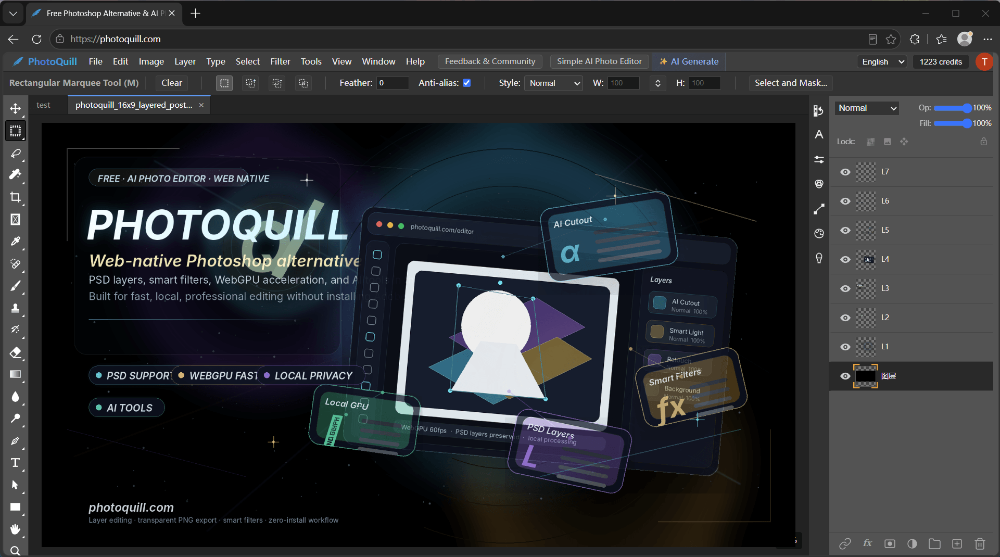](https://photoquill.com) | [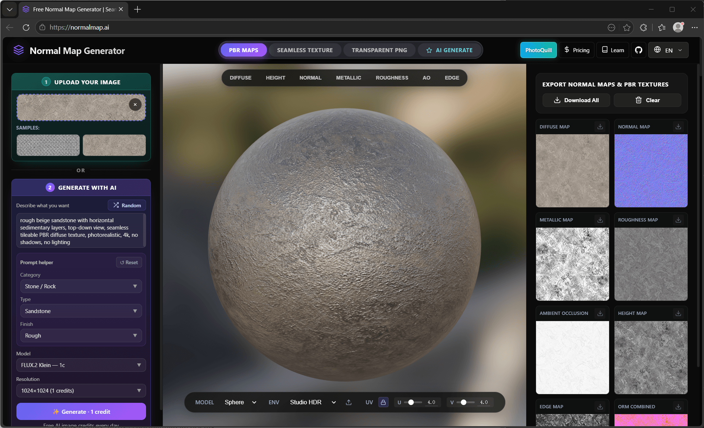](https://normalmap.ai) | [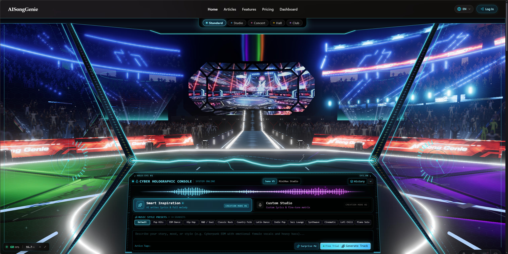](https://aisonggenie.com) |
| **Free AI Photo Editor (Photoshop Alternative)**<br>Runs in the browser with no installation. Supports PSD, RAW, and HDR layers, plus AI cutout, object removal, and outpainting. | **Free Normal Map & PBR Texture Generator**<br>Generates Normal, Roughness, Metallic, AO, Height, and ORM maps locally in your browser via WebGPU/WebGL. | **Free AI Song & BGM Generator**<br>Creates royalty-free music and background tracks from text prompts or lyrics for 3D demos, web games, and interactive sites. |

## Running Locally

```bash
git clone --recursive https://github.com/crazytoolsteam/ThreeJSAI.git
```

- **Plain HTML demos**: Open the project folder in `showcases/` and run `python -m http.server 8080`.
- **Vite / React projects**: If the folder contains `package.json`, run `npm install && npm run dev`.
- **WebGPU demos**: Recommended to run in the latest Chrome or Edge.

## Showcase Gallery

### WebGPU Rendering (55)

| | |
| :--- | :--- |
| <a href="./showcases/pissang__mutracer/">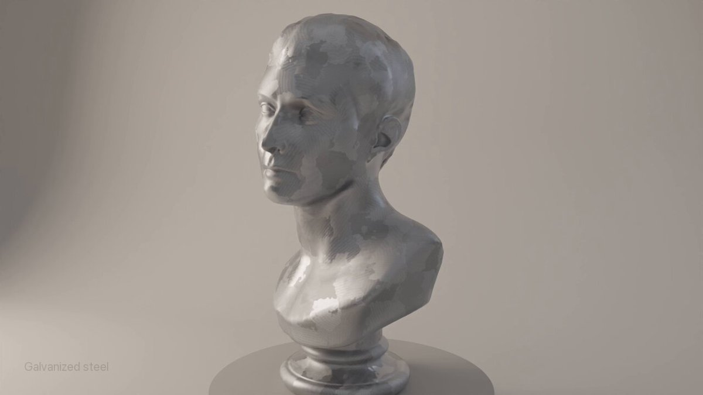</a><br><br>**[Yi Shen releases procedural MaterialX path tracing in WebGPU](./showcases/pissang__mutracer/)**<br>By Yi Shen (@pissang1)<br>Source: [`pissang/mutracer`](./showcases/pissang__mutracer/) | <a href="./showcases/huiskylabs__cold-smoke/">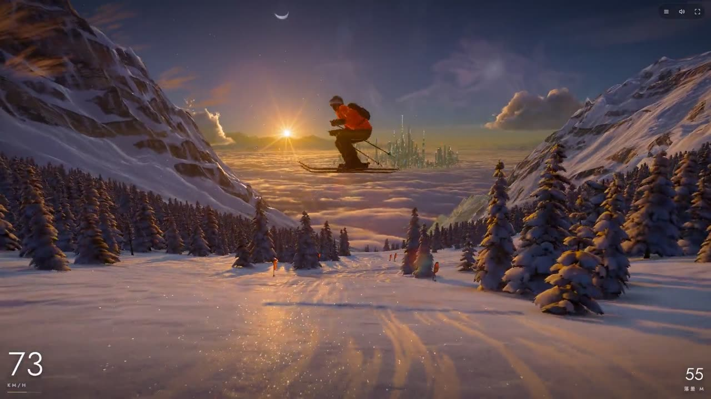</a><br><br>**[Huisky's Cold Smoke, an endless ski game in one HTML file](./showcases/huiskylabs__cold-smoke/)**<br>By Huisky (@huiskylabs)<br>Source: [`huiskylabs/cold-smoke`](./showcases/huiskylabs__cold-smoke/) |
| <a href="./showcases/akella__codevember-2026/">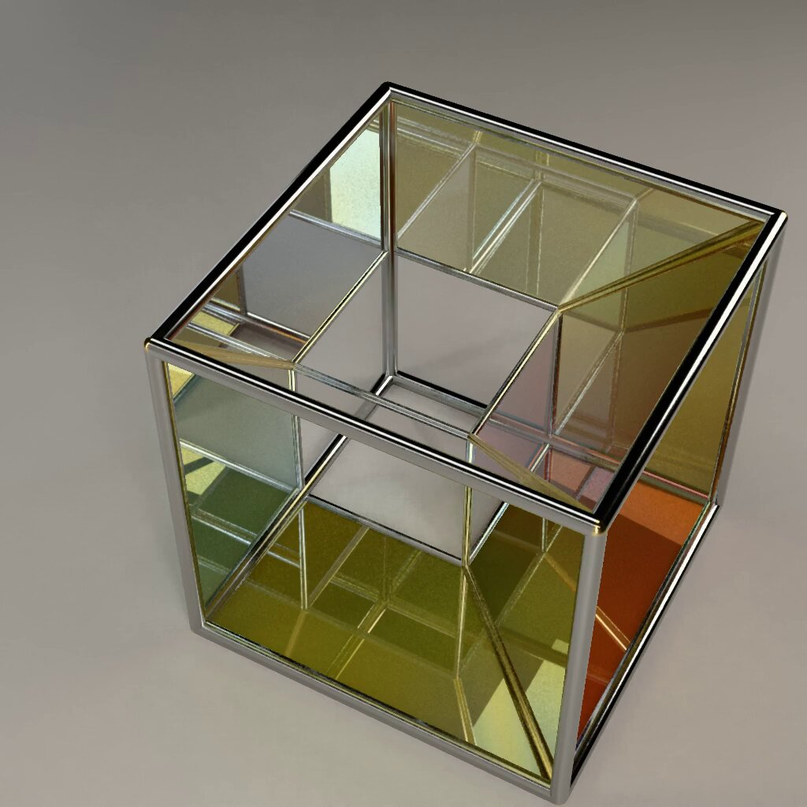</a><br><br>**[Akella explores real-time path-traced 4D tesseract animations](./showcases/akella__codevember-2026/)**<br>By akella (@akella)<br>Source: [`akella/codevember-2026`](./showcases/akella__codevember-2026/) | <a href="./showcases/samg-coder__solstice-garden/">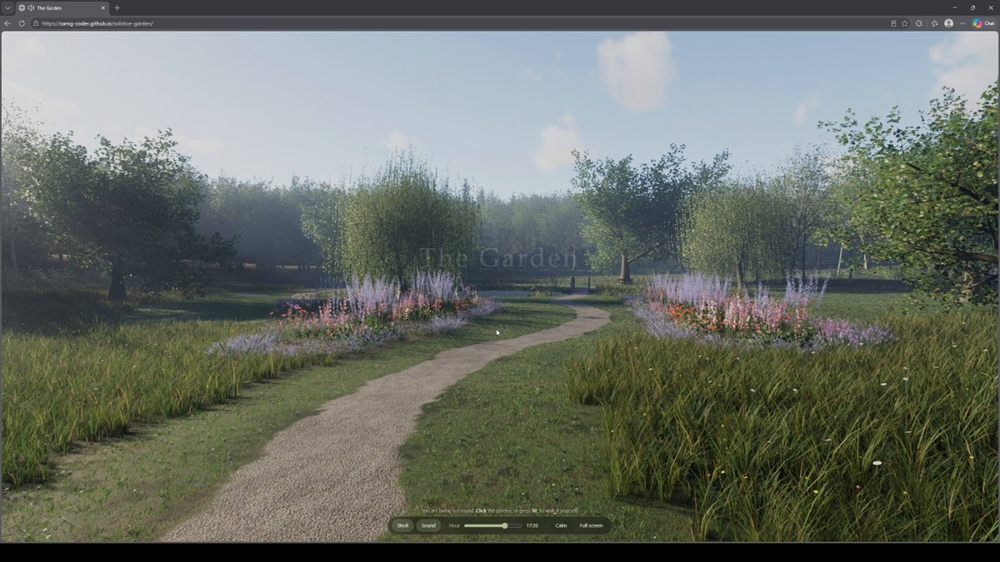</a><br><br>**[SamG presents The Garden](./showcases/samg-coder__solstice-garden/)**<br>By SamG (@SamGCoder)<br>Source: [`samg-coder/solstice-garden`](./showcases/samg-coder__solstice-garden/) |
| <a href="./showcases/playcanvas__engine/">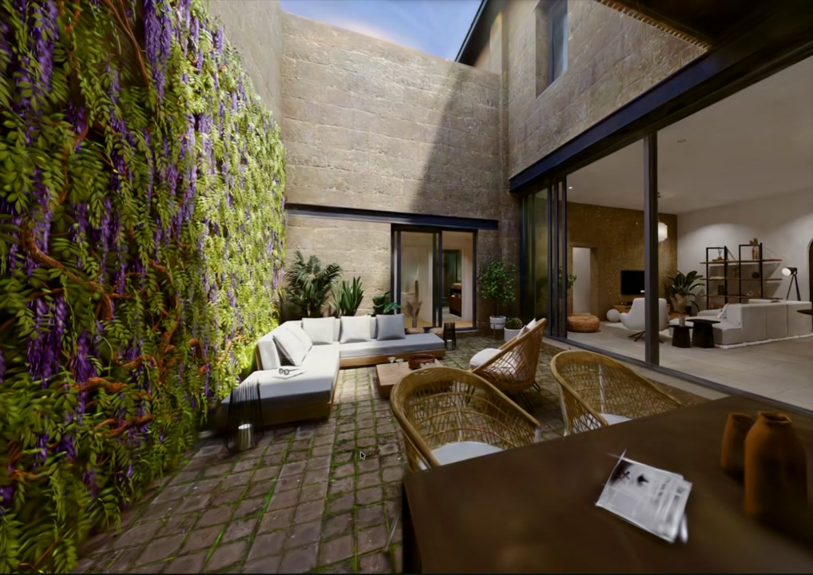</a><br><br>**[Martin Valigursky's Matrix digital rain shader for splats](./showcases/playcanvas__engine/)**<br>By Martin Valigursky (@ValigurskyM)<br>Source: [`playcanvas/engine`](./showcases/playcanvas__engine/)<br>File: `scripts/esm/gsplat/shader-effect-glyph-rain.mjs` | <a href="./showcases/samg-coder__solstice/">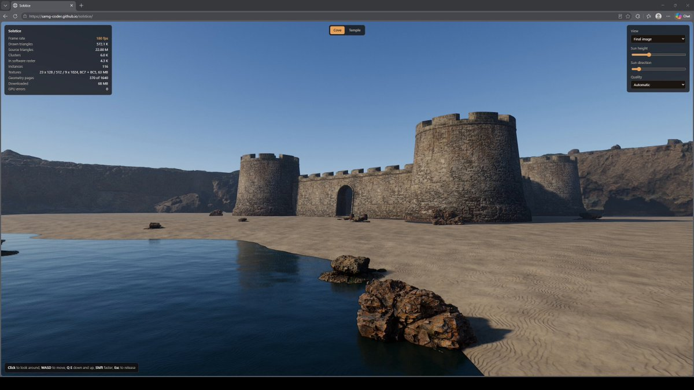</a><br><br>**[The Solstice Rust and WebGPU renderer implements continuous](./showcases/samg-coder__solstice/)**<br>By SamG (@SamGCoder)<br>Source: [`samg-coder/solstice`](./showcases/samg-coder__solstice/) |
| <a href="./showcases/lejrimostfa__force-field-vfx-threejs/">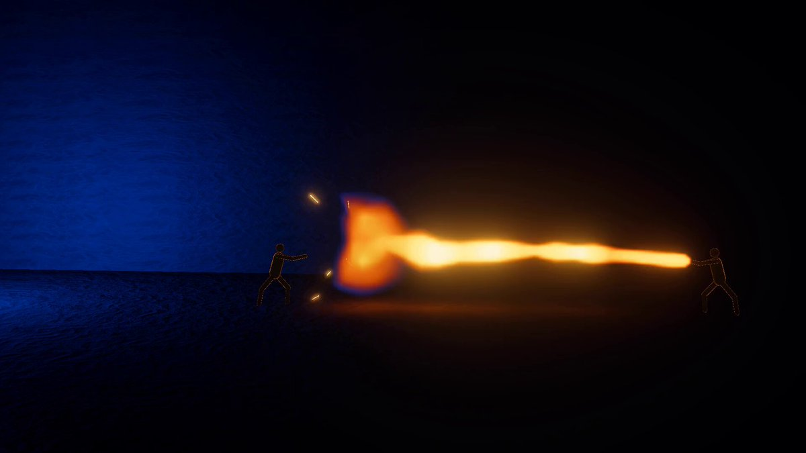</a><br><br>**[Fastmax remakes a Niagara force field effect in Three.js WebGPU](./showcases/lejrimostfa__force-field-vfx-threejs/)**<br>By Fastmax (@Fastmax_)<br>Source: [`lejrimostfa/force-field-vfx-threejs`](./showcases/lejrimostfa__force-field-vfx-threejs/) | <a href="./showcases/greggman__gen-city-auto/">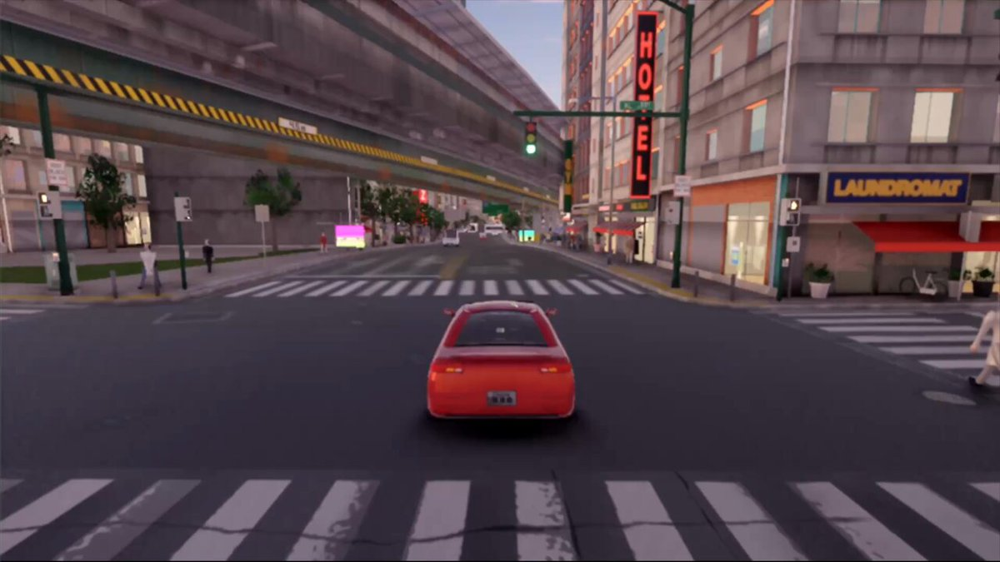</a><br><br>**[Greggman builds a zero-dependency procedural WebGPU metropolis](./showcases/greggman__gen-city-auto/)**<br>By greggman (@greggman)<br>Source: [`greggman/gen-city-auto`](./showcases/greggman__gen-city-auto/) |
| <a href="./showcases/repalash__three-motionbricks/">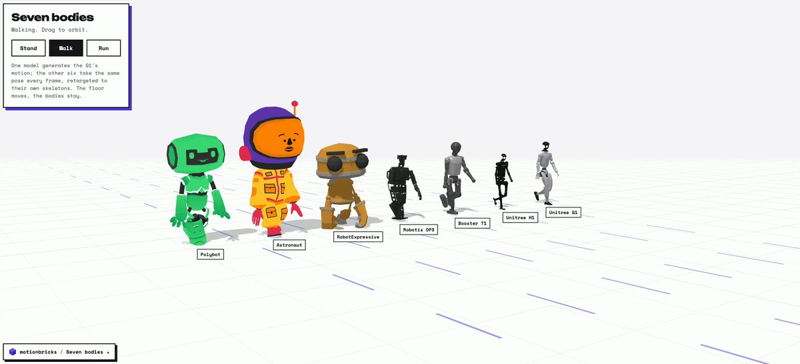</a><br><br>**[Quick example port of nvidia's motionbricks in @threejs](./showcases/repalash__three-motionbricks/)**<br>By Palash Bansal (@repalash)<br>Source: [`repalash/three-motionbricks`](./showcases/repalash__three-motionbricks/) | <a href="./showcases/mrdoob__three.js/">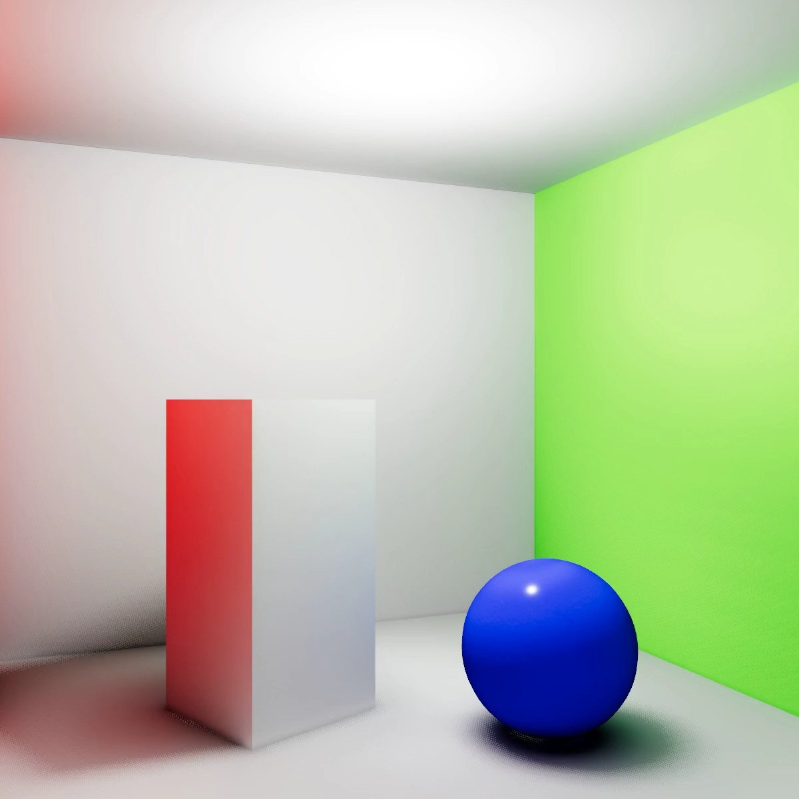</a><br><br>**[Three.js Official Release R187](./showcases/mrdoob__three.js/)**<br>By Three.js (@threejs)<br>Source: [`mrdoob/three.js`](./showcases/mrdoob__three.js/) |
| <a href="./showcases/mrdoob__three.js/">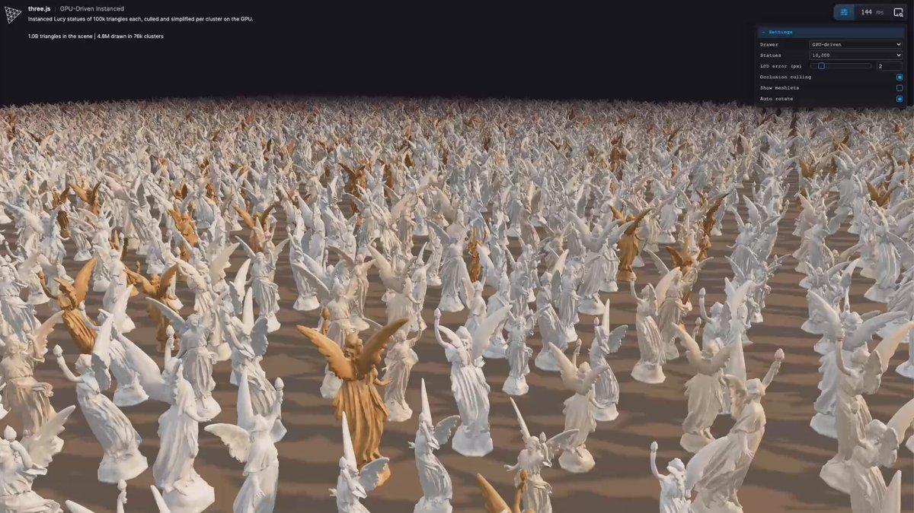</a><br><br>**[Three.js GPU Meshlet LOD Geometry System](./showcases/mrdoob__three.js/)**<br>By Dan Greenheck (@dangreenheck)<br>Source: [`mrdoob/three.js`](./showcases/mrdoob__three.js/) | <a href="./showcases/sparkjsdev__spark/">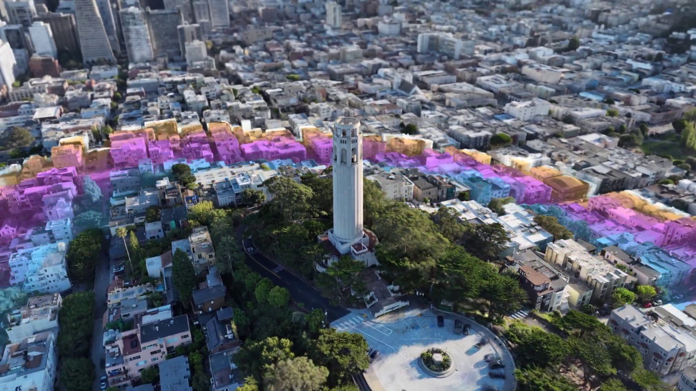</a><br><br>**[Spark Engineering Team Introduces Spark Radix, an Experimental](./showcases/sparkjsdev__spark/)**<br>By spark (@sparkjsdev)<br>Source: [`sparkjsdev/spark`](./showcases/sparkjsdev__spark/) |
| <a href="./showcases/redcamel__RedGPU/">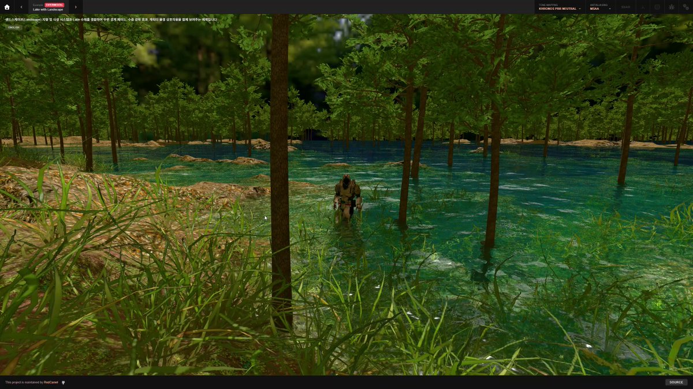</a><br><br>**[RedGPU v4.4 High-Performance WebGPU Graphics Engine](./showcases/redcamel__RedGPU/)**<br>By redcamel (@redcamel15)<br>Source: [`redcamel/RedGPU`](./showcases/redcamel__RedGPU/) | <a href="./showcases/SamG-Coder__BakedVoxelLighting/">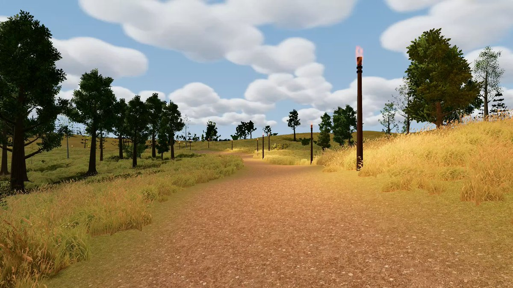</a><br><br>**[16km² Open-World WebGPU Voxel Landscape & Cached HLOD](./showcases/SamG-Coder__BakedVoxelLighting/)**<br>By SamG (@SamGCoder)<br>Source: [`SamG-Coder/BakedVoxelLighting`](./showcases/SamG-Coder__BakedVoxelLighting/) |
| <a href="./showcases/agargaro__instanced-mesh/">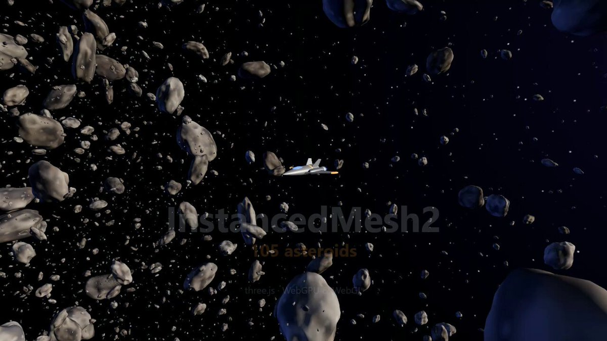</a><br><br>**[Andrea Gargaro's InstancedMesh2 flies through 250,000 asteroids](./showcases/agargaro__instanced-mesh/)**<br>By Andrea Gargaro (@agargaro_dev)<br>Source: [`agargaro/instanced-mesh`](./showcases/agargaro__instanced-mesh/) | <a href="./showcases/mikefernandez-pro__a-crown-of-ice-and-fire/">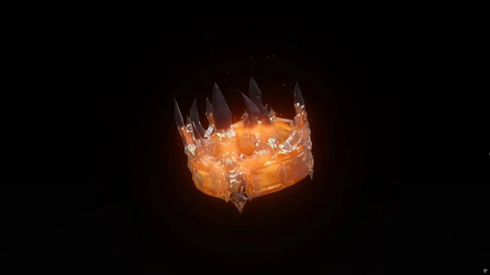</a><br><br>**[Mike Fernandez's A Crown of Ice and Fire, a WebGPU SDF shader](./showcases/mikefernandez-pro__a-crown-of-ice-and-fire/)**<br>By Rahzell83 (@Rahzell83)<br>Source: [`mikefernandez-pro/a-crown-of-ice-and-fire`](./showcases/mikefernandez-pro__a-crown-of-ice-and-fire/) |
| <a href="./showcases/playcanvas__engine/">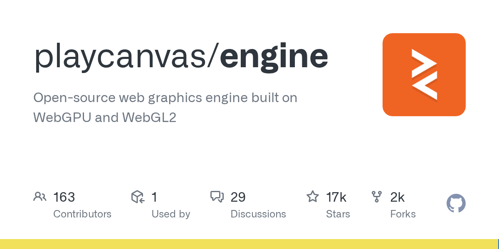</a><br><br>**[PlayCanvas adds a dynamic sky and atmosphere system in WebGPU](./showcases/playcanvas__engine/)**<br>By ValigurskyM (@ValigurskyM)<br>Source: [`playcanvas/engine`](./showcases/playcanvas__engine/) | <a href="./showcases/codrops__CinemaSeatPreview/">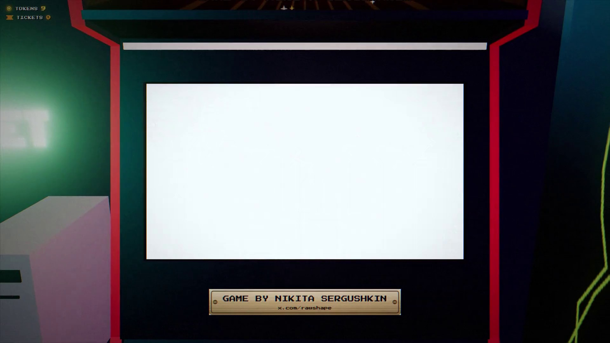</a><br><br>**[Codrops reimagines a 3D cinema seat selector](./showcases/codrops__CinemaSeatPreview/)**<br>By codrops (@codrops)<br>Source: [`codrops/CinemaSeatPreview`](./showcases/codrops__CinemaSeatPreview/) |
| <a href="./showcases/pissang__mutracer/">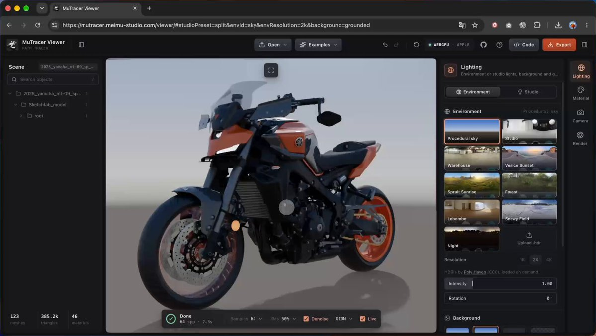</a><br><br>**[Open-Source WebGPU Physically-Based Path Tracer](./showcases/pissang__mutracer/)**<br>By Yi Shen (@pissang1)<br>Source: [`pissang/mutracer`](./showcases/pissang__mutracer/) | <a href="./showcases/bhouston__three-gpu-pathtracer-fidelity/">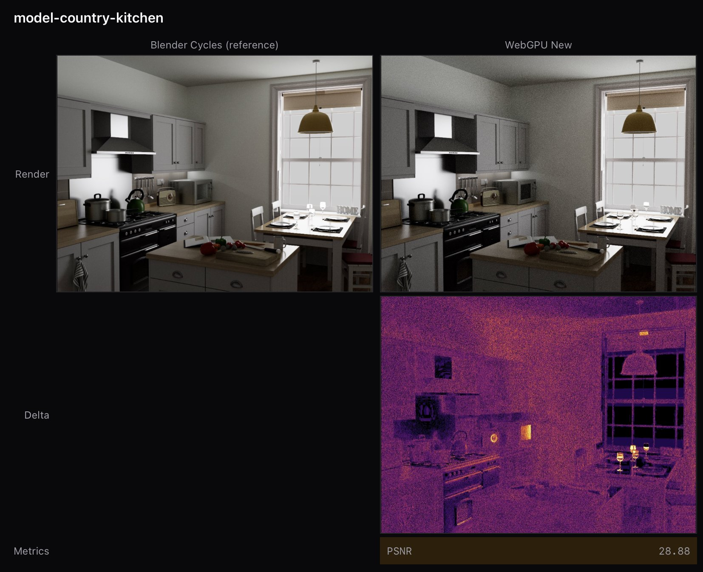</a><br><br>**[Ben Houston tests three-gpu-pathtracer against Blender renders](./showcases/bhouston__three-gpu-pathtracer-fidelity/)**<br>By Ben Houston (@benhouston3d)<br>Source: [`bhouston/three-gpu-pathtracer-fidelity`](./showcases/bhouston__three-gpu-pathtracer-fidelity/) |
| <a href="./showcases/gkjohnson__three-gpu-pathtracer/">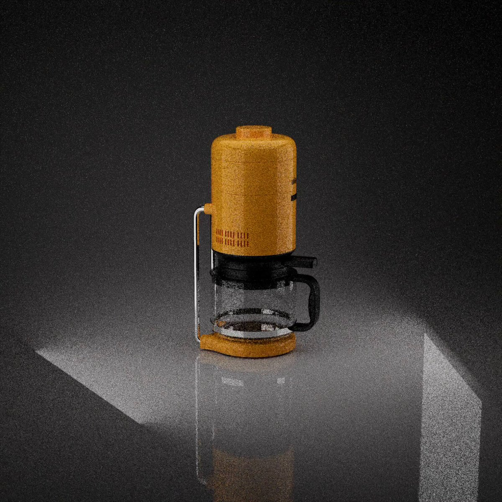</a><br><br>**[Garrett Johnson merges WebGPU into three-gpu-pathtracer](./showcases/gkjohnson__three-gpu-pathtracer/)**<br>By Garrett Johnson (@garrettkjohnson)<br>Source: [`gkjohnson/three-gpu-pathtracer`](./showcases/gkjohnson__three-gpu-pathtracer/) | <a href="./showcases/dgreenheck__threejs-particle-fluids/">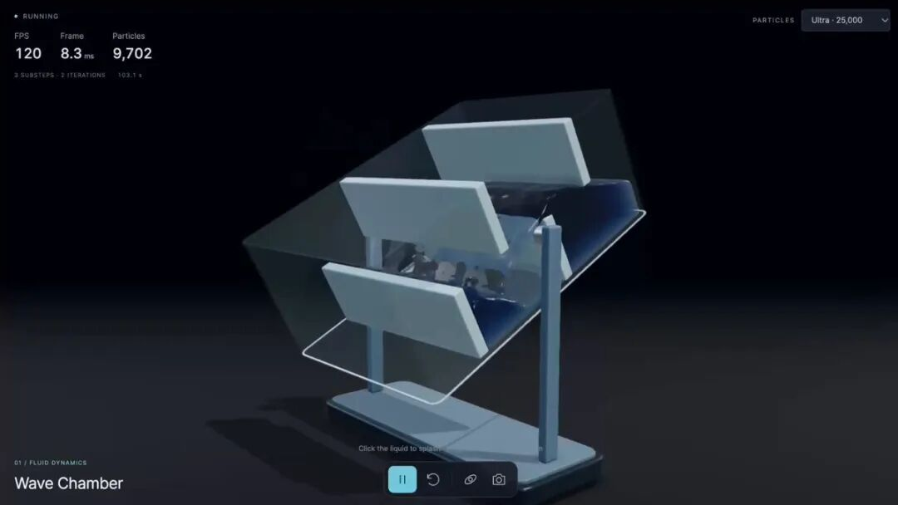</a><br><br>**[Dan Greenheck Open-sources Three.js Particle Fluids for WebGPU](./showcases/dgreenheck__threejs-particle-fluids/)**<br>By dangreenheck (@dangreenheck)<br>Source: [`dgreenheck/threejs-particle-fluids`](./showcases/dgreenheck__threejs-particle-fluids/) |
| <a href="./showcases/greggman__webgpu-driving/">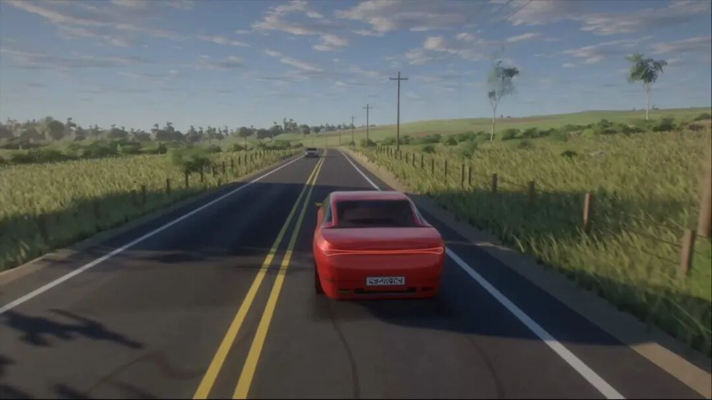</a><br><br>**[Gregg Tavares releases WebGPU Driving, an endless highway drive](./showcases/greggman__webgpu-driving/)**<br>By greggman (@greggman)<br>Source: [`greggman/webgpu-driving`](./showcases/greggman__webgpu-driving/) | <a href="./showcases/openshaders__openshaders/">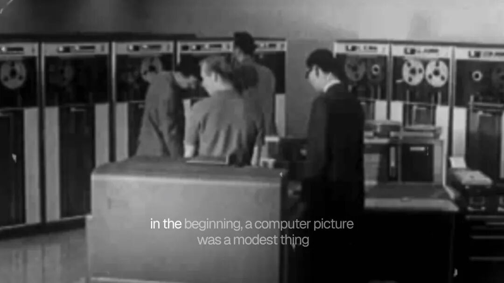</a><br><br>**[David Haz launches OpenShaders for WebGL and WebGPU](./showcases/openshaders__openshaders/)**<br>By davidhaz (@davidhaz)<br>Source: [`openshaders/openshaders`](./showcases/openshaders__openshaders/) |
| <a href="./showcases/playcanvas__supersplat/">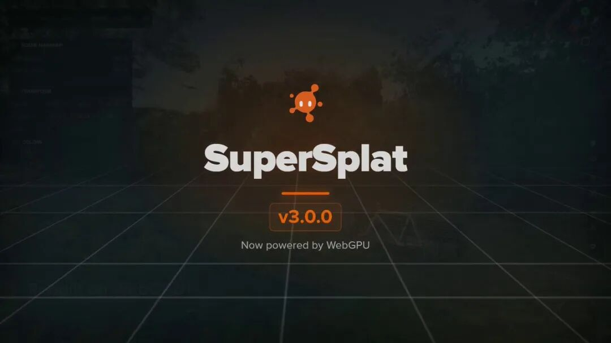</a><br><br>**[PlayCanvas launches SuperSplat Editor 3.0 on WebGPU](./showcases/playcanvas__supersplat/)**<br>By playcanvas (@playcanvas)<br>Source: [`playcanvas/supersplat`](./showcases/playcanvas__supersplat/) | <a href="./showcases/mrdoob__three.js/">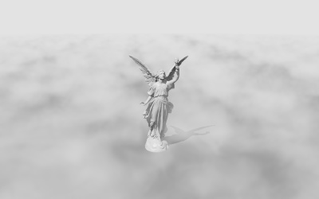</a><br><br>**[Volumetric Fog, an official Three.js WebGPU example](./showcases/mrdoob__three.js/)**<br>By three.js (@threejs)<br>Source: [`mrdoob/three.js`](./showcases/mrdoob__three.js/)<br>File: `examples/webgpu_postprocessing_fog.html` |
| <a href="./showcases/mrdoob__three.js/">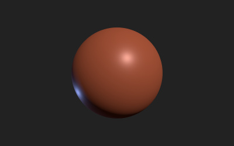</a><br><br>**[Sculpt, an official Three.js WebGPU example for mesh sculpting](./showcases/mrdoob__three.js/)**<br>By three.js (@threejs)<br>Source: [`mrdoob/three.js`](./showcases/mrdoob__three.js/)<br>File: `examples/webgpu_sculpt.html` | <a href="./showcases/mrdoob__three.js/">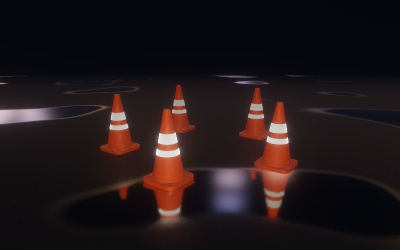</a><br><br>**[Retroreflective Materials, an official Three.js WebGPU example](./showcases/mrdoob__three.js/)**<br>By three.js (@threejs)<br>Source: [`mrdoob/three.js`](./showcases/mrdoob__three.js/)<br>File: `examples/webgpu_materials_retroreflection.html` |
| <a href="./showcases/mrdoob__three.js/">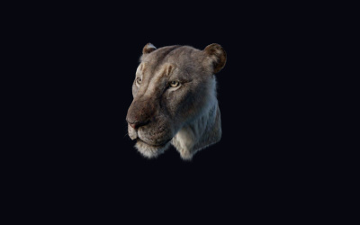</a><br><br>**[Gaussian Splatting, a new official Three.js WebGPU example](./showcases/mrdoob__three.js/)**<br>By three.js (@threejs)<br>Source: [`mrdoob/three.js`](./showcases/mrdoob__three.js/)<br>File: `examples/webgpu_gaussian_splat.html` | <a href="./showcases/mrdoob__three.js/">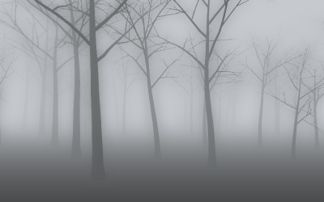</a><br><br>**[Fog Scattering, an improved official Three.js WebGPU example](./showcases/mrdoob__three.js/)**<br>By three.js (@threejs)<br>Source: [`mrdoob/three.js`](./showcases/mrdoob__three.js/)<br>File: `examples/webgpu_custom_fog_scattering.html` |
| <a href="./showcases/vibe-stack__super-terrain/">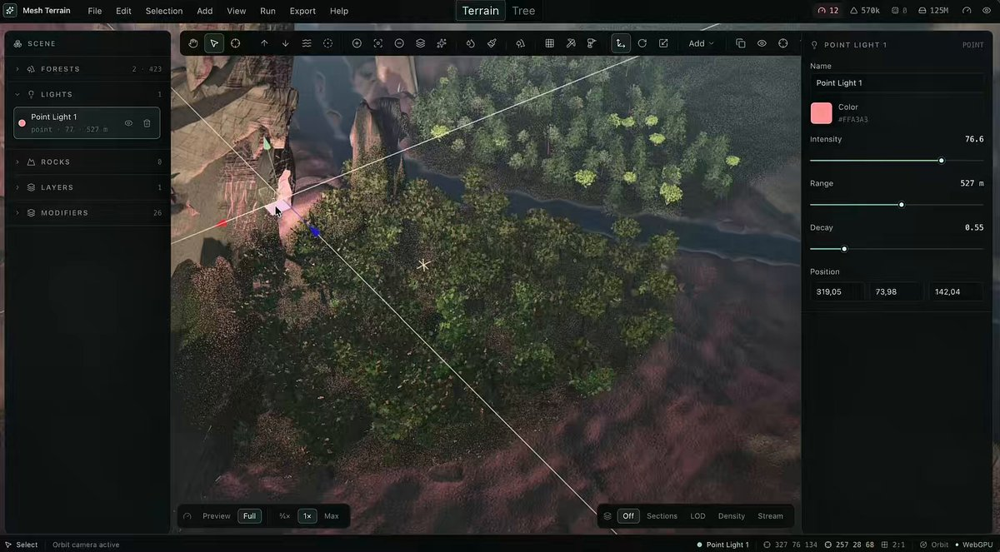</a><br><br>**[Alightinastorm releases free open-source forests for Three.js](./showcases/vibe-stack__super-terrain/)**<br>By robot 2.0 (@alightinastorm)<br>Source: [`vibe-stack/super-terrain`](./showcases/vibe-stack__super-terrain/) | <a href="./showcases/norio__speedball-gi/">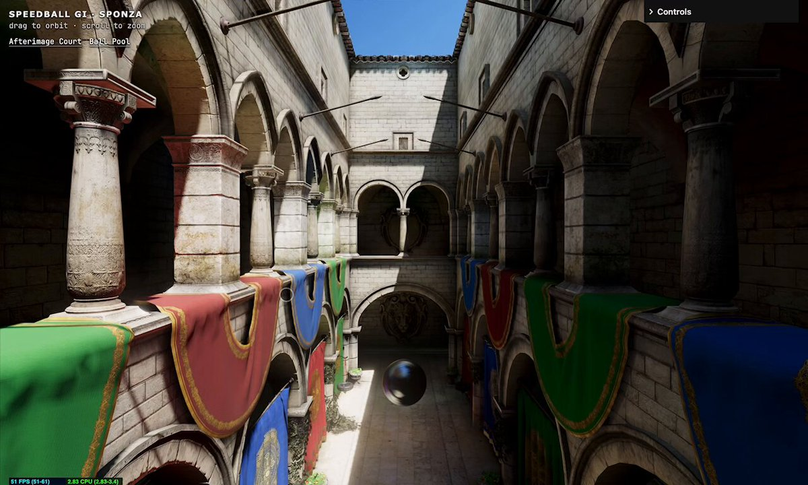</a><br><br>**[Norio adds GTAO, TRAA and bloom to Speedball GI in Three.js](./showcases/norio__speedball-gi/)**<br>By norio (@norio)<br>Source: [`norio/speedball-gi`](./showcases/norio__speedball-gi/) |
| <a href="./showcases/mrdoob__three.js/">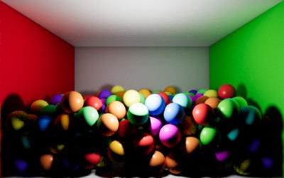</a><br><br>**[SSGI Ball Pool, a Three.js stress test for screen-space GI](./showcases/mrdoob__three.js/)**<br>By Benjamin Springer (@Ben__Springer)<br>Source: [`mrdoob/three.js`](./showcases/mrdoob__three.js/)<br>File: `examples/webgpu_postprocessing_ssgi_ballpool.html` | <a href="./showcases/ekimroyrp__260716_DLACoral/">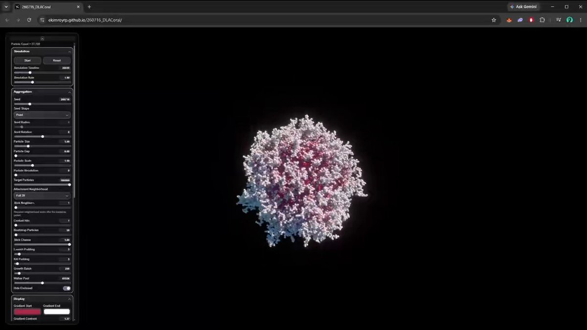</a><br><br>**[Ekim's DLA Coral grows coral with diffusion-limited aggregation](./showcases/ekimroyrp__260716_DLACoral/)**<br>By ekim (@ekimroyrp)<br>Source: [`ekimroyrp/260716_DLACoral`](./showcases/ekimroyrp__260716_DLACoral/) |
| <a href="./showcases/pajama-studio__lowpoly-tree-generator/">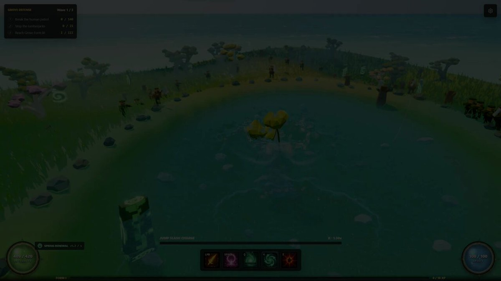</a><br><br>**[Tree Forge started as a tree generator and became a game](./showcases/pajama-studio__lowpoly-tree-generator/)**<br>By Pajama Studio (@pajama_studio)<br>Source: [`pajama-studio/lowpoly-tree-generator`](./showcases/pajama-studio__lowpoly-tree-generator/) | <a href="./showcases/cl0nazepamm__sigils/">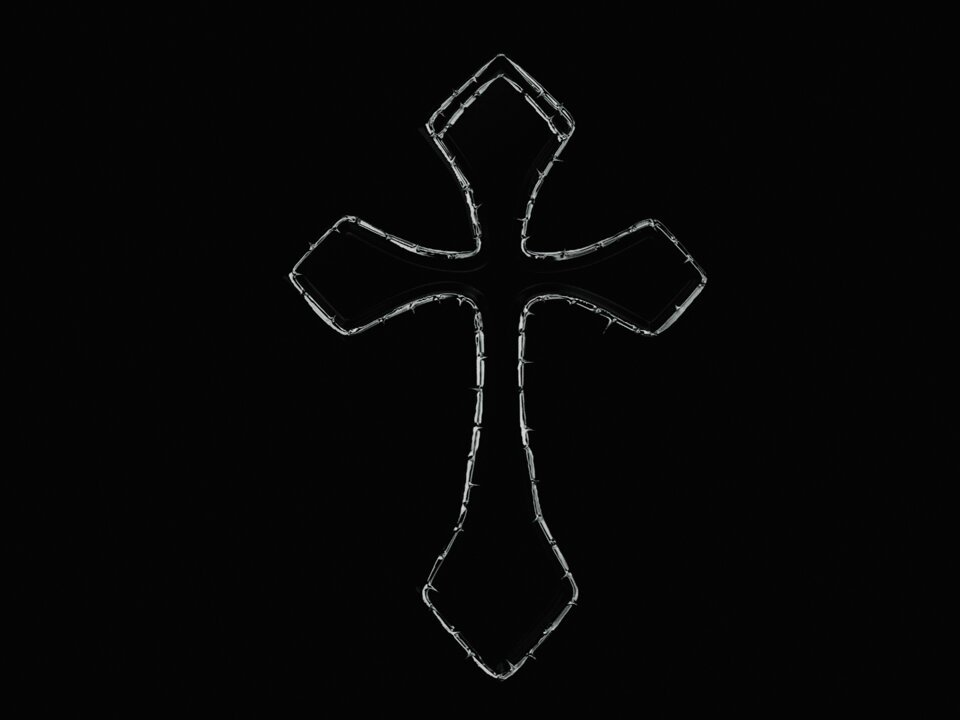</a><br><br>**[Clone2k's Sigils Creator renders drawn metal sigils in WebGPU](./showcases/cl0nazepamm__sigils/)**<br>By clone2k (@cl0ne2k)<br>Source: [`cl0nazepamm/sigils`](./showcases/cl0nazepamm__sigils/) |
| <a href="./showcases/prinzipiell__tsl/">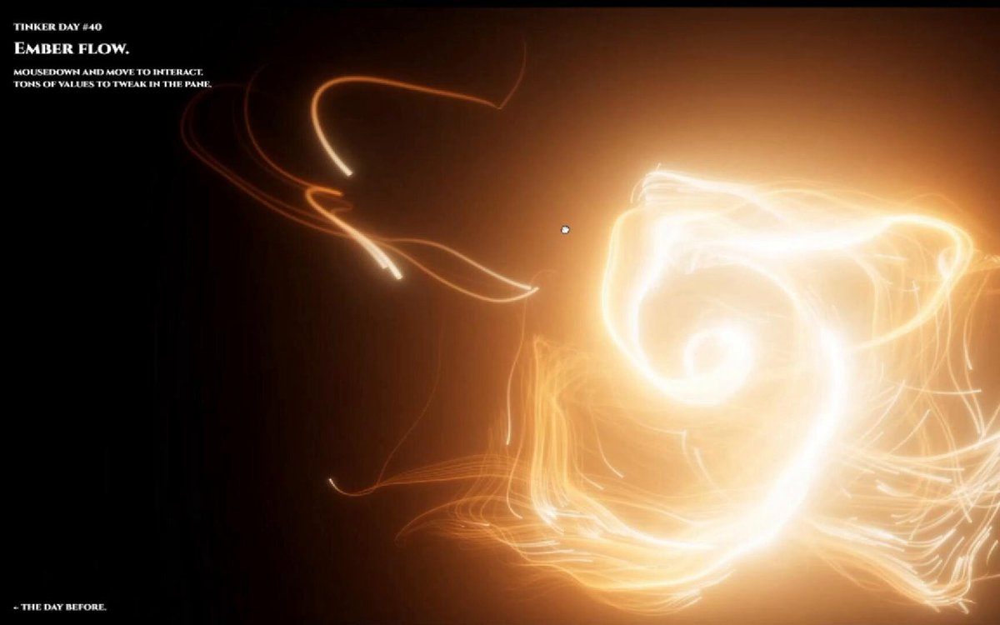</a><br><br>**[Ember Flow: Curl Noise in WebGPU and TSL](./showcases/prinzipiell__tsl/)**<br>By Frank Reitberger (@_pwd_)<br>Source: [`prinzipiell/tsl`](./showcases/prinzipiell__tsl/) | <a href="./showcases/hexianWeb__lego-stylized-nature/">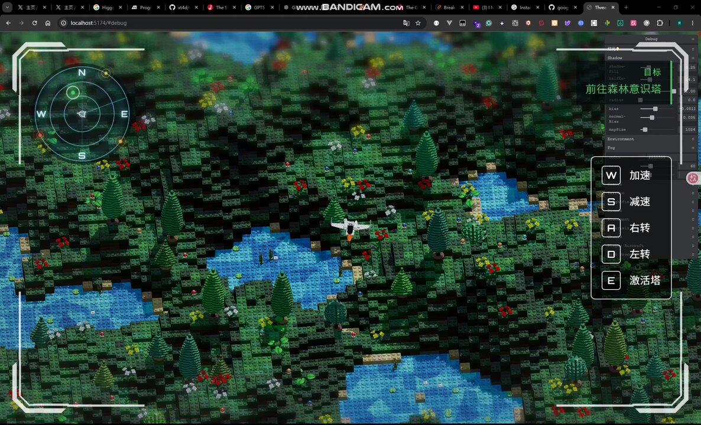</a><br><br>**[Three.js + LEGO + Procedural Terrain: A Flyable LEGO World](./showcases/hexianWeb__lego-stylized-nature/)**<br>By hexianWeb (@hexian37496562)<br>Source: [`hexianWeb/lego-stylized-nature`](./showcases/hexianWeb__lego-stylized-nature/) |
| <a href="./showcases/cl0nazepamm__speedball/">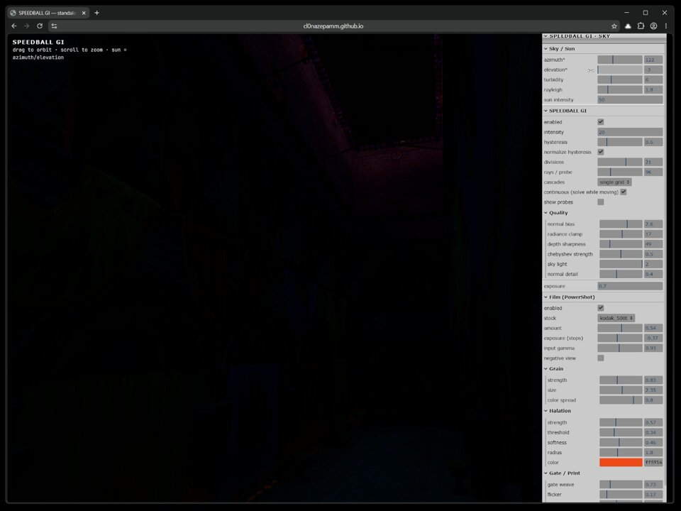</a><br><br>**[Clone2k's Speedball GI brings real-time DDGI to Three.js](./showcases/cl0nazepamm__speedball/)**<br>By clone2k (@cl0ne2k)<br>Source: [`cl0nazepamm/speedball`](./showcases/cl0nazepamm__speedball/) | <a href="./showcases/Faraz-Portfolio__demo-2026-r3f-inspector/">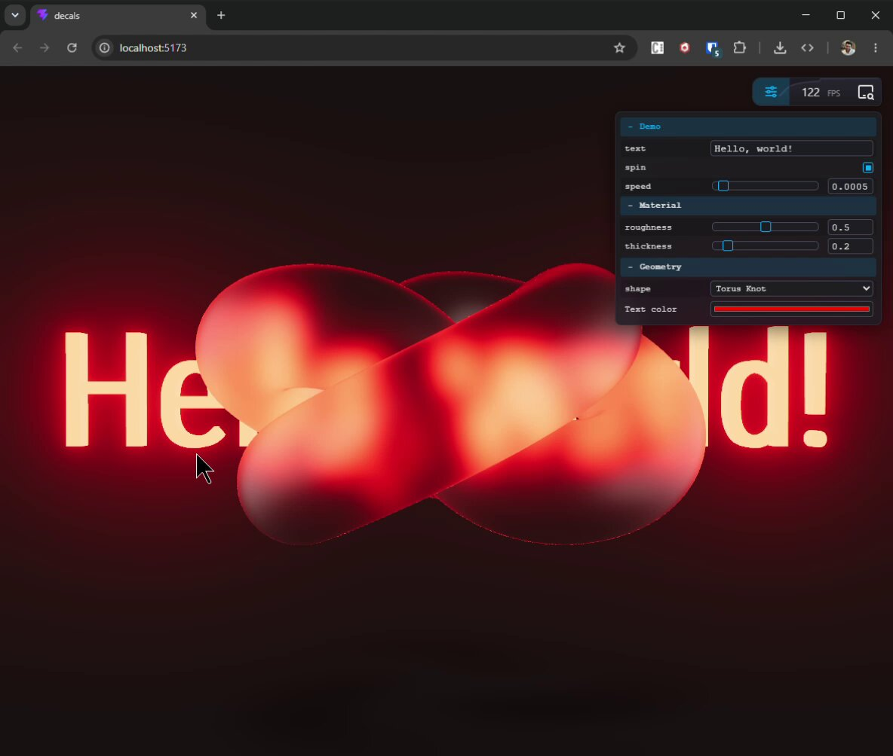</a><br><br>**[Faraz shows how to use the Three.js WebGPU inspector in R3F](./showcases/Faraz-Portfolio__demo-2026-r3f-inspector/)**<br>By Faraz (@CantBeFaraz)<br>Source: [`Faraz-Portfolio/demo-2026-r3f-inspector`](./showcases/Faraz-Portfolio__demo-2026-r3f-inspector/) |
| <a href="./showcases/mrdoob__three.js/"></a><br><br>**[Volumetric Fire Simulation, an official Three.js WebGPU example](./showcases/mrdoob__three.js/)**<br>By three.js (@threejs)<br>Source: [`mrdoob/three.js`](./showcases/mrdoob__three.js/)<br>File: `examples/webgpu_volume_fire.html` | <a href="./showcases/mrdoob__three.js/">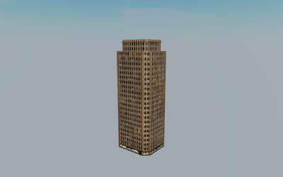</a><br><br>**[Building Generator, an official Three.js WebGPU example](./showcases/mrdoob__three.js/)**<br>By three.js (@threejs)<br>Source: [`mrdoob/three.js`](./showcases/mrdoob__three.js/)<br>File: `examples/webgpu_generator_building.html` |
| <a href="./showcases/mrdoob__three.js/">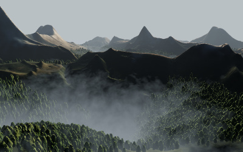</a><br><br>**[mrdoob's Custom Height Fog example for Three.js WebGPU](./showcases/mrdoob__three.js/)**<br>By mrdoob (@mrdoob)<br>Source: [`mrdoob/three.js`](./showcases/mrdoob__three.js/)<br>File: `examples/webgpu_custom_fog.html` | <a href="./showcases/Manishbhai9350__Curvy-Project-Showcase/">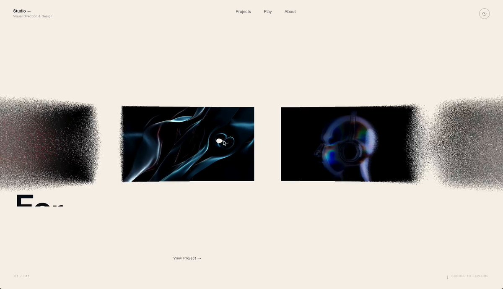</a><br><br>**[Manish's project cards bend like film when you scroll fast](./showcases/Manishbhai9350__Curvy-Project-Showcase/)**<br>By WebGL / WebGPU (@WebGL_WebGPU)<br>Source: [`Manishbhai9350/Curvy-Project-Showcase`](./showcases/Manishbhai9350__Curvy-Project-Showcase/) |
| <a href="./showcases/mrdoob__three.js/">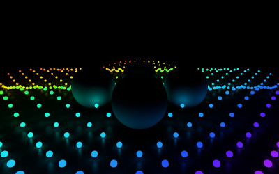</a><br><br>**[mrdoob's Clustered Lighting example for Three.js WebGPU](./showcases/mrdoob__three.js/)**<br>By mrdoob (@mrdoob)<br>Source: [`mrdoob/three.js`](./showcases/mrdoob__three.js/)<br>File: `examples/webgpu_lights_clustered.html` | <a href="./showcases/mrdoob__three.js/">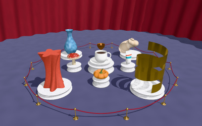</a><br><br>**[mrdoob adds LoftGeometry to Three.js with a new example](./showcases/mrdoob__three.js/)**<br>By mrdoob (@mrdoob)<br>Source: [`mrdoob/three.js`](./showcases/mrdoob__three.js/)<br>File: `examples/webgpu_geometry_loft.html` |
| <a href="./showcases/ekimroyrp__260610_ChladniCymatics/">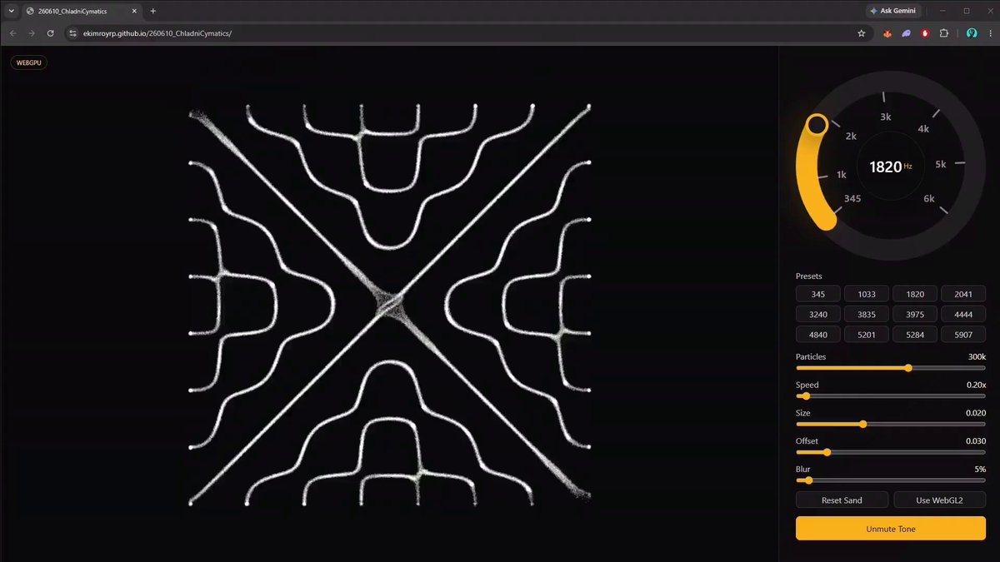</a><br><br>**[Ekim's Chladni Cymatics turns sound frequencies into patterns](./showcases/ekimroyrp__260610_ChladniCymatics/)**<br>By ekim (@ekimroyrp)<br>Source: [`ekimroyrp/260610_ChladniCymatics`](./showcases/ekimroyrp__260610_ChladniCymatics/) | <a href="./showcases/mrdoob__three.js/">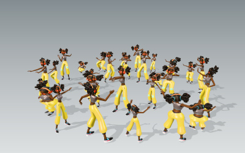</a><br><br>**[Renaud's skinning instancing example lands in Three.js](./showcases/mrdoob__three.js/)**<br>By Renaud (@onirenaud)<br>Source: [`mrdoob/three.js`](./showcases/mrdoob__three.js/)<br>File: `examples/webgpu_skinning_instancing_individual.html` |
| <a href="./showcases/mrdoob__three.js/"></a><br><br>**[mrdoob's Light Probe Volume example loads a baked Sponza grid](./showcases/mrdoob__three.js/)**<br>By mrdoob (@mrdoob)<br>Source: [`mrdoob/three.js`](./showcases/mrdoob__three.js/)<br>File: `examples/webgpu_lightprobes_sponza.html` | <a href="./showcases/yufengjie97__three-demo/"></a><br><br>**[Glow Crystal: Bloom and Grass Materials in Three.js WebGPU TSL](./showcases/yufengjie97__three-demo/)**<br>By yufengjie (@sun_7410)<br>Source: [`yufengjie97/three-demo`](./showcases/yufengjie97__three-demo/) |
| <a href="./showcases/yufengjie97__three-demo/"></a><br><br>**[MaterialX Noise Boids Simulation in Three.js TSL](./showcases/yufengjie97__three-demo/)**<br>By yufengjie (@sun_7410)<br>Source: [`yufengjie97/three-demo`](./showcases/yufengjie97__three-demo/) | <a href="./showcases/yufengjie97__three-demo/"></a><br><br>**[Line, Tube and Ball WebGPU TSL Demo in Three.js](./showcases/yufengjie97__three-demo/)**<br>By yufengjie (@sun_7410)<br>Source: [`yufengjie97/three-demo`](./showcases/yufengjie97__three-demo/) |
| <a href="./showcases/promontis__threejs-pom/"></a><br><br>**[Threejs-pom, parallax occlusion mapping for Three.js WebGPU](./showcases/promontis__threejs-pom/)**<br>By Michel van den Berg (@promontis)<br>Source: [`promontis/threejs-pom`](./showcases/promontis__threejs-pom/) | <a href="./showcases/artcodev__three-fluid-fx/"></a><br><br>**[Artem Korenevych's three-fluid-fx, a drop-in fluid solver](./showcases/artcodev__three-fluid-fx/)**<br>By Artem Korenevych (@artcreativecode)<br>Source: [`artcodev/three-fluid-fx`](./showcases/artcodev__three-fluid-fx/) |
| <a href="./showcases/wehwayne2__weisdevice-project/"></a><br><br>**[Wei Built a DJ-able Three.js Island Portfolio](./showcases/wehwayne2__weisdevice-project/)**<br>By WebGL / WebGPU (@WebGL_WebGPU)<br>Source: [`wehwayne2/weisdevice-project`](./showcases/wehwayne2__weisdevice-project/) |  |

### 3D Games & Interactive (24)

| | |
| :--- | :--- |
| <a href="./showcases/danielwh2__sprite-stacking/"></a><br><br>**[Daniel White builds 3D sprite stacking agent skill](./showcases/danielwh2__sprite-stacking/)**<br>By Daniel White (@dwhitedesign)<br>Source: [`danielwh2/sprite-stacking`](./showcases/danielwh2__sprite-stacking/) | <a href="./showcases/loktar00__lanternfall/"></a><br><br>**[Lanternfall: Isometric Action Dungeon Crawler in Three.js](./showcases/loktar00__lanternfall/)**<br>By Three.js (@threejs)<br>Source: [`loktar00/lanternfall`](./showcases/loktar00__lanternfall/) |
| <a href="./showcases/zseven-w__dsh-game-studio/"></a><br><br>**[Open-source Web Game Studio With Three.js Voxel Templates](./showcases/zseven-w__dsh-game-studio/)**<br>By Fini.Yang (@FiniYang)<br>Source: [`zseven-w/dsh-game-studio`](./showcases/zseven-w__dsh-game-studio/) | <a href="./showcases/mdhasibul35__skyshard/"></a><br><br>**[Indie Developer Hasibdreamer35 Built Skyshard, a Playable 3D](./showcases/mdhasibul35__skyshard/)**<br>By Hasibul Hasan (@hasibdreamer35)<br>Source: [`mdhasibul35/skyshard`](./showcases/mdhasibul35__skyshard/) |
| <a href="./showcases/vibegameengine__hyperreal-starter-kit/"></a><br><br>**[Modern Web3d Starter Kit Built on Three.js](./showcases/vibegameengine__hyperreal-starter-kit/)**<br>By PashaIGooD (@PashaIGooD)<br>Source: [`vibegameengine/hyperreal-starter-kit`](./showcases/vibegameengine__hyperreal-starter-kit/) | <a href="./showcases/vibegameengine__web-starter-kit/"></a><br><br>**[Indie Developer Pasha Refines a Browser 3D Character Controller](./showcases/vibegameengine__web-starter-kit/)**<br>By PashaIGooD (@PashaIGooD)<br>Source: [`vibegameengine/web-starter-kit`](./showcases/vibegameengine__web-starter-kit/) |
| <a href="./showcases/jeantimex__tokyo/"></a><br><br>**[Jeantimex's Procedural Tokyo, an open-source city in Three.js](./showcases/jeantimex__tokyo/)**<br>By jeantimex (@jeantimex)<br>Source: [`jeantimex/tokyo`](./showcases/jeantimex__tokyo/) | <a href="./showcases/drcollect__demolition-derby/"></a><br><br>**[Demolition Derby, a Destruction Derby-style game by drcollect](./showcases/drcollect__demolition-derby/)**<br>By three.js (@threejs)<br>Source: [`drcollect/demolition-derby`](./showcases/drcollect__demolition-derby/) |
| <a href="./showcases/xikhar__spiderbench/"></a><br><br>**[Xikhar's third-person action web game reaches its third version](./showcases/xikhar__spiderbench/)**<br>By xikhar (@xikhar)<br>Source: [`xikhar/spiderbench`](./showcases/xikhar__spiderbench/) | <a href="./showcases/sbobyn__three-avbd/"></a><br><br>**[Nybobs' Teardown-inspired Three.js voxel destruction game](./showcases/sbobyn__three-avbd/)**<br>By nybobs (@nybobs)<br>Source: [`sbobyn/three-avbd`](./showcases/sbobyn__three-avbd/) |
| <a href="./showcases/ingel81__3dtd/"></a><br><br>**[3DTD, a tower defense game played on your actual street](./showcases/ingel81__3dtd/)**<br>By Garrett Johnson (@garrettkjohnson)<br>Source: [`ingel81/3dtd`](./showcases/ingel81__3dtd/) | <a href="./showcases/Rabneba__stick-steel/"></a><br><br>**[Stick & Steel, a hand-drawn sword duel game in the browser](./showcases/Rabneba__stick-steel/)**<br>By genex_games (@genex_games)<br>Source: [`Rabneba/stick-steel`](./showcases/Rabneba__stick-steel/) |
| <a href="./showcases/mike007jd__voxel-musou/"></a><br><br>**[BubuAi builds Along the River During Qingming with GPT-6 Astra](./showcases/mike007jd__voxel-musou/)**<br>By BubuAi (@BubuStd)<br>Source: [`mike007jd/voxel-musou`](./showcases/mike007jd__voxel-musou/) | <a href="./showcases/Kevin-Liu-01__Claude-of-Tanks/"></a><br><br>**[Claude of Tanks, a free browser tank game with 311 vehicles](./showcases/Kevin-Liu-01__Claude-of-Tanks/)**<br>By three.js (@threejs)<br>Source: [`Kevin-Liu-01/Claude-of-Tanks`](./showcases/Kevin-Liu-01__Claude-of-Tanks/) |
| <a href="./showcases/franky-adl__water-ring-toss-game/"></a><br><br>**[Water Ring Toss, the retro handheld water game in Three.js](./showcases/franky-adl__water-ring-toss-game/)**<br>By three.js (@threejs)<br>Source: [`franky-adl/water-ring-toss-game`](./showcases/franky-adl__water-ring-toss-game/) | <a href="./showcases/boytchev__scorm/"></a><br><br>**[Pavel Boytchev's Euler Grill, a VR lesson on polyhedra](./showcases/boytchev__scorm/)**<br>By Pavel Boytchev (@PavelBoytchev)<br>Source: [`boytchev/scorm`](./showcases/boytchev__scorm/) |
| <a href="./showcases/e01-ai__starfall/"></a><br><br>**[Starfall, a Homeworld-style space RTS written by Claude Opus 5](./showcases/e01-ai__starfall/)**<br>By nooooob (@mikeluan123)<br>Source: [`e01-ai/starfall`](./showcases/e01-ai__starfall/) | <a href="./showcases/MengTo__Skills/"></a><br><br>**[Skills for Creating an Action RPG with Three.js](./showcases/MengTo__Skills/)**<br>By Meng To (@MengTo)<br>Source: [`MengTo/Skills`](./showcases/MengTo__Skills/) |
| <a href="./showcases/KilledByAPixel__LittleJS/"></a><br><br>**[Frank Force's plugin pairs the LittleJS engine with Three.js](./showcases/KilledByAPixel__LittleJS/)**<br>By Frank Force 🌻 (@KilledByAPixel)<br>Source: [`KilledByAPixel/LittleJS`](./showcases/KilledByAPixel__LittleJS/) | <a href="./showcases/xt4d__GameBlocks/"></a><br><br>**[GameBlocks: Open-source 3D Game Blocks for Coding Agents](./showcases/xt4d__GameBlocks/)**<br>By wsad (@spt4d)<br>Source: [`xt4d/GameBlocks`](./showcases/xt4d__GameBlocks/) |
| <a href="./showcases/daveseidman__watertoy/"></a><br><br>**[Dave Seidman's Water Toy brings the ring toss toy to Three.js](./showcases/daveseidman__watertoy/)**<br>By Dave Seidman (@daveseidman)<br>Source: [`daveseidman/watertoy`](./showcases/daveseidman__watertoy/) | <a href="./showcases/mrdoob__three-descent/"></a><br><br>**[Three.js Descent, mrdoob's port of Descent to the browser](./showcases/mrdoob__three-descent/)**<br>By mrdoob (@mrdoob)<br>Source: [`mrdoob/three-descent`](./showcases/mrdoob__three-descent/) |
| <a href="./showcases/mrdoob__three-quake/"></a><br><br>**[Three.js Quake, mrdoob's port of Quake to Three.js](./showcases/mrdoob__three-quake/)**<br>By mrdoob (@mrdoob)<br>Source: [`mrdoob/three-quake`](./showcases/mrdoob__three-quake/) | <a href="./showcases/jasonkneen__tiny-world-builder/"></a><br><br>**[Jason Kneen's Tiny World Builder, a voxel world editor](./showcases/jasonkneen__tiny-world-builder/)**<br>By Jason Kneen (@jasonkneen)<br>Source: [`jasonkneen/tiny-world-builder`](./showcases/jasonkneen__tiny-world-builder/) |

### Other Showcases (19)

| | |
| :--- | :--- |
| <a href="./showcases/apekshik__three-nanite/"></a><br><br>**[Apek's three-nanite brings Nanite-style geometry to Three.js](./showcases/apekshik__three-nanite/)**<br>By apek (@apekshik)<br>Source: [`apekshik/three-nanite`](./showcases/apekshik__three-nanite/) | <a href="./showcases/meshy-dev__ThreeRT/"></a><br><br>**[ThreeRT brings hardware-accelerated path tracing to Three.js](./showcases/meshy-dev__ThreeRT/)**<br>By ThreeRT (@ThreeRT3D)<br>Source: [`meshy-dev/ThreeRT`](./showcases/meshy-dev__ThreeRT/) |
| <a href="./showcases/mjurczyk__three-environment-shadows/"></a><br><br>**[Ambient Shadow Mapping for Three.js From HDR Environment Maps](./showcases/mjurczyk__three-environment-shadows/)**<br>By mjurczyk 🦖 (@thefrontendcat)<br>Source: [`mjurczyk/three-environment-shadows`](./showcases/mjurczyk__three-environment-shadows/) | <a href="./showcases/amirmushichge__bottle-studio/"></a><br><br>**[Amir Mušić's glass wine bottle atelier in one Three.js file](./showcases/amirmushichge__bottle-studio/)**<br>By AmirMušić (@AmirMushich)<br>Source: [`amirmushichge/bottle-studio`](./showcases/amirmushichge__bottle-studio/) |
| <a href="./showcases/WilliamLiu-1997__Gaussian-Splat-Lite/"></a><br><br>**[3D Gaussian Splatting Web Renderer With Progressive Streaming](./showcases/WilliamLiu-1997__Gaussian-Splat-Lite/)**<br>By William Liu (@lyzzz97)<br>Source: [`WilliamLiu-1997/Gaussian-Splat-Lite`](./showcases/WilliamLiu-1997__Gaussian-Splat-Lite/) | <a href="./showcases/WilliamLiu-1997__Gaussian-Splat-Lite/"></a><br><br>**[Lyzzz97's SH codebooks halve Gaussian-Splat-Lite file sizes](./showcases/WilliamLiu-1997__Gaussian-Splat-Lite/)**<br>By William Liu (@lyzzz97)<br>Source: [`WilliamLiu-1997/Gaussian-Splat-Lite`](./showcases/WilliamLiu-1997__Gaussian-Splat-Lite/)<br>File: `docs/BuildRad.md` |
| <a href="./showcases/OpenSenseNova__SenseNova-6.8-Code2Video/"></a><br><br>**[SenseNova 6.8 Code2Video, an open model coding 3D animations](./showcases/OpenSenseNova__SenseNova-6.8-Code2Video/)**<br>By Nahid (@nahid_pro09)<br>Source: [`OpenSenseNova/SenseNova-6.8-Code2Video`](./showcases/OpenSenseNova__SenseNova-6.8-Code2Video/) | <a href="./showcases/DayDream-Technologies__3d-db/"></a><br><br>**[Engaging Real-time 3D Database Visualization Utility](./showcases/DayDream-Technologies__3d-db/)**<br>By manto_vincenzo (@manto_vincenzo)<br>Source: [`DayDream-Technologies/3d-db`](./showcases/DayDream-Technologies__3d-db/) |
| <a href="./showcases/SkyeShark__Eanpa-Sky/"></a><br><br>**[Utah Teapot's Eanpa Sky 0.2.1, volumetric clouds for Three.js](./showcases/SkyeShark__Eanpa-Sky/)**<br>By SkyeSharkie (@SkyeSharkie)<br>Source: [`SkyeShark/Eanpa-Sky`](./showcases/SkyeShark__Eanpa-Sky/) | <a href="./showcases/ybouane__tiltshift-in-html/"></a><br><br>**[Tiltshift-in-HTML: an HTML-in-canvas Three.js Experiment](./showcases/ybouane__tiltshift-in-html/)**<br>By Yassine Bouanane (@ybouane)<br>Source: [`ybouane/tiltshift-in-html`](./showcases/ybouane__tiltshift-in-html/) |
| <a href="./showcases/rishabdesigns__vive/"></a><br><br>**[Built this Space-station Themed 3D Site with Three.js](./showcases/rishabdesigns__vive/)**<br>By Rishabh Joshi (@rishabhjoshii)<br>Source: [`rishabdesigns/vive`](./showcases/rishabdesigns__vive/) | <a href="./showcases/NourMtir0722__Paperlab/"></a><br><br>**[Nawwara open-sources Paperlab, paper you can fold on the web](./showcases/NourMtir0722__Paperlab/)**<br>By Nawwara (@noormtir)<br>Source: [`NourMtir0722/Paperlab`](./showcases/NourMtir0722__Paperlab/) |
| <a href="./showcases/lo-th__backroom/"></a><br><br>**[Backroom 0.0.1, an early Backrooms-style scene by lo-th](./showcases/lo-th__backroom/)**<br>By three.js (@threejs)<br>Source: [`lo-th/backroom`](./showcases/lo-th__backroom/) | <a href="./showcases/cullenwebber__three-volumetric-light/"></a><br><br>**[Cullen Webber's volumetric light and skeletal animation demo](./showcases/cullenwebber__three-volumetric-light/)**<br>By Cullen Webber (@SinzVII)<br>Source: [`cullenwebber/three-volumetric-light`](./showcases/cullenwebber__three-volumetric-light/) |
| <a href="./showcases/vaexenc__gcintro/"></a><br><br>**[The Nintendo GameCube intro animation recreated in Three.js](./showcases/vaexenc__gcintro/)**<br>By three.js (@threejs)<br>Source: [`vaexenc/gcintro`](./showcases/vaexenc__gcintro/) | <a href="./showcases/mohAmineBrs__lab-wiggle-scanner/"></a><br><br>**[Wiggly 3D Models Projected Onto a Render Target](./showcases/mohAmineBrs__lab-wiggle-scanner/)**<br>By mooh  (@moohdev)<br>Source: [`mohAmineBrs/lab-wiggle-scanner`](./showcases/mohAmineBrs__lab-wiggle-scanner/) |
| <a href="./showcases/sengchor__kokraf/"></a><br><br>**[Kokraf launches one-click AI texturing for 3D models](./showcases/sengchor__kokraf/)**<br>By Kokraf (@kokraf3d)<br>Source: [`sengchor/kokraf`](./showcases/sengchor__kokraf/) | <a href="./showcases/codedgar__three-fenestra/"></a><br><br>**[Presenting Three-fenestra!](./showcases/codedgar__three-fenestra/)**<br>By Codedgar (@codedgar_dev)<br>Source: [`codedgar/three-fenestra`](./showcases/codedgar__three-fenestra/) |
| <a href="./showcases/ekimroyrp__260523_WoolyPaths/"></a><br><br>**[Ekim's Wooly Paths draws woolly trails in Three.js](./showcases/ekimroyrp__260523_WoolyPaths/)**<br>By ekim (@ekimroyrp)<br>Source: [`ekimroyrp/260523_WoolyPaths`](./showcases/ekimroyrp__260523_WoolyPaths/) |  |

### Shaders & VFX (17)

| | |
| :--- | :--- |
| <a href="./showcases/bilalgursen__liquid-glass/"></a><br><br>**[Bilal Gürşen creates open-source Liquid Glass shaders](./showcases/bilalgursen__liquid-glass/)**<br>By Bilal Gürşen (@bilalgursen777)<br>Source: [`bilalgursen/liquid-glass`](./showcases/bilalgursen__liquid-glass/) | <a href="./showcases/MengTo__Skills/"></a><br><br>**[Meng To crafts the Sylva Woodland 3D landing page in Three.js](./showcases/MengTo__Skills/)**<br>By Meng To (@MengTo)<br>Source: [`MengTo/Skills`](./showcases/MengTo__Skills/)<br>File: `agent-skills/web-design/sylva-field-guide-layout` |
| <a href="./showcases/piskelapp__piskel/"></a><br><br>**[Lunor shares 20 free GitHub tools for Opus 5.5](./showcases/piskelapp__piskel/)**<br>By Lunor (@0xLunor)<br>Source: [`piskelapp/piskel`](./showcases/piskelapp__piskel/) | <a href="./showcases/spite__codevember-2026/"></a><br><br>**[Jaume Sanchez Elias shared Membrane for Codevember 2026](./showcases/spite__codevember-2026/)**<br>By Jaume Sanchez Elias 🇺🇦 (@thespite)<br>Source: [`spite/codevember-2026`](./showcases/spite__codevember-2026/) |
| <a href="./showcases/realcodebear__saltline-fable-5.2/"></a><br><br>**[Felix Rieseberg builds Saltline, a 3D web game, with Fable 5.2](./showcases/realcodebear__saltline-fable-5.2/)**<br>By Felix Rieseberg (@felixrieseberg)<br>Source: [`realcodebear/saltline-fable-5.2`](./showcases/realcodebear__saltline-fable-5.2/) | <a href="./showcases/spite__codevember-2026/"></a><br><br>**[thespite's Void, an algorithmic shader experiment in Three.js](./showcases/spite__codevember-2026/)**<br>By Jaume Sanchez Elias 🇺🇦 (@thespite)<br>Source: [`spite/codevember-2026`](./showcases/spite__codevember-2026/) |
| <a href="./showcases/zz85__random-sketches/"></a><br><br>**[Codevember Zen Koi Pond](./showcases/zz85__random-sketches/)**<br>By Graphics Noob (@BlurSpline)<br>Source: [`zz85/random-sketches`](./showcases/zz85__random-sketches/) | <a href="./showcases/spite__codevember-2026/"></a><br><br>**[thespite shares a Codevember shattered glass experiment](./showcases/spite__codevember-2026/)**<br>By Jaume Sanchez Elias 🇺🇦 (@thespite)<br>Source: [`spite/codevember-2026`](./showcases/spite__codevember-2026/) |
| <a href="./showcases/codrops__LookbookHoverEffects/"></a><br><br>**[Codrops Lookbook Hover Effects: 8 WebGL Hover Interactions](./showcases/codrops__LookbookHoverEffects/)**<br>By Codrops (@codrops)<br>Source: [`codrops/LookbookHoverEffects`](./showcases/codrops__LookbookHoverEffects/) | <a href="./showcases/playcanvas__inspector/"></a><br><br>**[PlayCanvas adds a performance profiler to its inspector](./showcases/playcanvas__inspector/)**<br>By Martin Valigursky (@ValigurskyM)<br>Source: [`playcanvas/inspector`](./showcases/playcanvas__inspector/) |
| <a href="./showcases/mrdoob__slop-newyork/"></a><br><br>**[mrdoob's Slop New York, a drivable procedural Manhattan](./showcases/mrdoob__slop-newyork/)**<br>By mrdoob (@mrdoob)<br>Source: [`mrdoob/slop-newyork`](./showcases/mrdoob__slop-newyork/) | <a href="./showcases/Tezumie__ShaderMate/"></a><br><br>**[ShaderMate 2.0 Launches as an Open-source Shader Framework](./showcases/Tezumie__ShaderMate/)**<br>By Tezumies (@Tezumies)<br>Source: [`Tezumie/ShaderMate`](./showcases/Tezumie__ShaderMate/) |
| <a href="./showcases/playcanvas__engine/"></a><br><br>**[PlayCanvas Engine 2.23.0 boosts runtime performance up to 3.8x](./showcases/playcanvas__engine/)**<br>By playcanvas (@playcanvas)<br>Source: [`playcanvas/engine`](./showcases/playcanvas__engine/) | <a href="./showcases/mrdoob__three.js/"></a><br><br>**[Sky and Sun Shader, an official Three.js WebGL example](./showcases/mrdoob__three.js/)**<br>By three.js (@threejs)<br>Source: [`mrdoob/three.js`](./showcases/mrdoob__three.js/)<br>File: `examples/webgl_shaders_sky.html` |
| <a href="./showcases/alphardex__su7-replica/"></a><br><br>**[An open-source recreation of the Xiaomi SU7 site in Three.js](./showcases/alphardex__su7-replica/)**<br>By Mi1997_  (@Mizaza1997_)<br>Source: [`alphardex/su7-replica`](./showcases/alphardex__su7-replica/) | <a href="./showcases/achrefelouafi__RainSystemThreeJS/"></a><br><br>**[An open-source cinematic rainstorm for any model in Three.js](./showcases/achrefelouafi__RainSystemThreeJS/)**<br>By Chiro Visuals (@chirovisuals)<br>Source: [`achrefelouafi/RainSystemThreeJS`](./showcases/achrefelouafi__RainSystemThreeJS/) |
| <a href="./showcases/YasirAwan4831__holographic-shader-visualizer-three.Js/"></a><br><br>**[HOLO.SYS: Futuristic Holographic WebGL Project in Three.js](./showcases/YasirAwan4831__holographic-shader-visualizer-three.Js/)**<br>By Muhammad Yasir (@YasirAwan4831)<br>Source: [`YasirAwan4831/holographic-shader-visualizer-three.Js`](./showcases/YasirAwan4831__holographic-shader-visualizer-three.Js/) |  |

### Water & Fluids (12)

| | |
| :--- | :--- |
| <a href="./showcases/LukyVj__distortion-wave/"></a><br><br>**[Luky open-sources a GPU distortion wave wrapper for React](./showcases/LukyVj__distortion-wave/)**<br>By Luky - A$AP Luky (@LukyVJ)<br>Source: [`LukyVj/distortion-wave`](./showcases/LukyVj__distortion-wave/) | <a href="./showcases/mrdoob__codevember-2026/"></a><br><br>**[mrdoob releases Caustic for Codevember 2026](./showcases/mrdoob__codevember-2026/)**<br>By mrdoob (@mrdoob)<br>Source: [`mrdoob/codevember-2026`](./showcases/mrdoob__codevember-2026/) |
| <a href="./showcases/Humpalumps__Ultra-Water/"></a><br><br>**[Ultra-Performative WebGL 3D Particle Architecture](./showcases/Humpalumps__Ultra-Water/)**<br>By Ian (@Ian_cadle)<br>Source: [`Humpalumps/Ultra-Water`](./showcases/Humpalumps__Ultra-Water/) | <a href="./showcases/iamtechartist__boba-bar/"></a><br><br>**[Techartist's Boba Bar, a 3D bubble tea builder](./showcases/iamtechartist__boba-bar/)**<br>By techartist (@techartist_)<br>Source: [`iamtechartist/boba-bar`](./showcases/iamtechartist__boba-bar/) |
| <a href="./showcases/givros__lake-city/"></a><br><br>**[Givros builds Lake-City from a single GPT-6 Astra prompt](./showcases/givros__lake-city/)**<br>By givros (@givros)<br>Source: [`givros/lake-city`](./showcases/givros__lake-city/) | <a href="./showcases/scottiefox__caustic-volume/"></a><br><br>**[Opensource. Lite & Full Version](./showcases/scottiefox__caustic-volume/)**<br>By ScottieFox (@ScottieFoxTTV)<br>Source: [`scottiefox/caustic-volume`](./showcases/scottiefox__caustic-volume/) |
| <a href="./showcases/squall01337__abyssal-ocean/"></a><br><br>**[ABYSSAL, an open-source procedural ocean and tsunami sim](./showcases/squall01337__abyssal-ocean/)**<br>By Can Matrix (@Jomolos)<br>Source: [`squall01337/abyssal-ocean`](./showcases/squall01337__abyssal-ocean/) | <a href="./showcases/achrefelouafi__SnowSystemThreeJS/"></a><br><br>**[Opensource, Real-time Snowfall System Using @threejs & @webgl](./showcases/achrefelouafi__SnowSystemThreeJS/)**<br>By Chiro Visuals (@chirovisuals)<br>Source: [`achrefelouafi/SnowSystemThreeJS`](./showcases/achrefelouafi__SnowSystemThreeJS/) |
| <a href="./showcases/valeriangalliat__threejs-environment-water-and-sky/"></a><br><br>**[Val ports a Three.js water and sky scene to the latest release](./showcases/valeriangalliat__threejs-environment-water-and-sky/)**<br>By Val  (@valeriangalliat)<br>Source: [`valeriangalliat/threejs-environment-water-and-sky`](./showcases/valeriangalliat__threejs-environment-water-and-sky/) | <a href="./showcases/achrefelouafi__OceanThreejs/"></a><br><br>**[An open-source photorealistic FFT ocean in Three.js and WebGL2](./showcases/achrefelouafi__OceanThreejs/)**<br>By Chiro Visuals (@chirovisuals)<br>Source: [`achrefelouafi/OceanThreejs`](./showcases/achrefelouafi__OceanThreejs/) |
| <a href="./showcases/jeantimex__threejs-water/"></a><br><br>**[Completed Three.js Port of Evan Wallace's WebGL Water Demo](./showcases/jeantimex__threejs-water/)**<br>By jeantimex (@jeantimex)<br>Source: [`jeantimex/threejs-water`](./showcases/jeantimex__threejs-water/) | <a href="./showcases/gioeledallapozza__FFTOCEAN/"></a><br><br>**[WebGL Fft Ocean V1.0 is Officially Wrapped](./showcases/gioeledallapozza__FFTOCEAN/)**<br>By Gioele Dalla Pozza (@DallaPozzaG)<br>Source: [`gioeledallapozza/FFTOCEAN`](./showcases/gioeledallapozza__FFTOCEAN/) |

### Architecture & Cities (9)

| | |
| :--- | :--- |
| <a href="./showcases/achrefelouafi__building-configurator-threejs/"></a><br><br>**[chirovisuals's VolumeCraft Building Configurator in Three.js](./showcases/achrefelouafi__building-configurator-threejs/)**<br>By Chiro Visuals (@chirovisuals)<br>Source: [`achrefelouafi/building-configurator-threejs`](./showcases/achrefelouafi__building-configurator-threejs/) | <a href="./showcases/achrefelouafi__BuildingGeneratorThreeJS/"></a><br><br>**[Open-source procedural architecture generator in Three.js](./showcases/achrefelouafi__BuildingGeneratorThreeJS/)**<br>By XtraAI (@XtraAi)<br>Source: [`achrefelouafi/BuildingGeneratorThreeJS`](./showcases/achrefelouafi__BuildingGeneratorThreeJS/) |
| <a href="./showcases/zz85__slop-singapore/"></a><br><br>**[Slop Singapore, a Three.js sim of real Singapore streets](./showcases/zz85__slop-singapore/)**<br>By Graphics Noob (@BlurSpline)<br>Source: [`zz85/slop-singapore`](./showcases/zz85__slop-singapore/) | <a href="./showcases/dennisivy__church-of-the-savior/"></a><br><br>**[Dennis Ivy rebuilds the Church of the Savior in Three.js](./showcases/dennisivy__church-of-the-savior/)**<br>By dennisivy11 (@dennisivy11)<br>Source: [`dennisivy/church-of-the-savior`](./showcases/dennisivy__church-of-the-savior/) |
| <a href="./showcases/img2threejs__plugin-interior/"></a><br><br>**[NickDevFE's img2interior v2.2 turns images into 3D interiors](./showcases/img2threejs__plugin-interior/)**<br>By NickDevFE (@NickDevFE)<br>Source: [`img2threejs/plugin-interior`](./showcases/img2threejs__plugin-interior/) | <a href="./showcases/Khalidabdi1__factory/"></a><br><br>**[Khalid simulates a train from city to village live in Three.js](./showcases/Khalidabdi1__factory/)**<br>By Khalid (@KhalidDevLog)<br>Source: [`Khalidabdi1/factory`](./showcases/Khalidabdi1__factory/) |
| <a href="./showcases/MengTo__towers/"></a><br><br>**[I Open-sourced My 3D Towers Building Site](./showcases/MengTo__towers/)**<br>By Meng To (@MengTo)<br>Source: [`MengTo/towers`](./showcases/MengTo__towers/) | <a href="./showcases/Thre4dripper__Infinity-Castle-ThreeJs/"></a><br><br>**[Infinity Castle, an endless procedural descent in Three.js](./showcases/Thre4dripper__Infinity-Castle-ThreeJs/)**<br>By Threadripper (@threadripper845)<br>Source: [`Thre4dripper/Infinity-Castle-ThreeJs`](./showcases/Thre4dripper__Infinity-Castle-ThreeJs/) |
| <a href="./showcases/mrdoob__three.js/"></a><br><br>**[mrdoob's City Generator example adds store interiors and people](./showcases/mrdoob__three.js/)**<br>By mrdoob (@mrdoob)<br>Source: [`mrdoob/three.js`](./showcases/mrdoob__three.js/)<br>File: `examples/webgpu_generator_city.html` |  |

### AI & Vibe Coding (7)

| | |
| :--- | :--- |
| <a href="./showcases/swapnilbhange__kutuhal-3d/"></a><br><br>**[Swapnil releases Kutuhal 3D, an open-source Claude plugin](./showcases/swapnilbhange__kutuhal-3d/)**<br>By Swapnil Bhange (@swapnil_1_618)<br>Source: [`swapnilbhange/kutuhal-3d`](./showcases/swapnilbhange__kutuhal-3d/) | <a href="./showcases/penpot__penpot/"></a><br><br>**[Rivvian details a 20-tool motion design framework for Opus 5.5](./showcases/penpot__penpot/)**<br>By rivvian (@0xrivvian)<br>Source: [`penpot/penpot`](./showcases/penpot__penpot/) |
| <a href="./showcases/google__three-live/"></a><br><br>**[Google open-sources Three-Live, an AI spatial playground](./showcases/google__three-live/)**<br>By Chuck Bass (@ChuckBass14291)<br>Source: [`google/three-live`](./showcases/google__three-live/) | <a href="./showcases/Moh4696__open-3d-skills/"></a><br><br>**[Open 3D Skills: Procedural 3D Development Suite](./showcases/Moh4696__open-3d-skills/)**<br>By Shlcy (@CY160909)<br>Source: [`Moh4696/open-3d-skills`](./showcases/Moh4696__open-3d-skills/) |
| <a href="./showcases/winchxyz__moon-rover/"></a><br><br>**[Winch's REGOLITH, a lunar rover sim made with Opus 5](./showcases/winchxyz__moon-rover/)**<br>By winch (@winchxyz)<br>Source: [`winchxyz/moon-rover`](./showcases/winchxyz__moon-rover/) | <a href="./showcases/mrdoob__toys/"></a><br><br>**[mrdoob makes a wooden toy maker with Fable and box3d.js](./showcases/mrdoob__toys/)**<br>By mrdoob (@mrdoob)<br>Source: [`mrdoob/toys`](./showcases/mrdoob__toys/) |
| <a href="./showcases/earthtojake__text-to-cad/"></a><br><br>**[Text-to-cad, an open-source CAD harness for Codex and Claude](./showcases/earthtojake__text-to-cad/)**<br>By Jake Fitzgerald (@earthtojake)<br>Source: [`earthtojake/text-to-cad`](./showcases/earthtojake__text-to-cad/) |  |

### Characters & Animation (4)

| | |
| :--- | :--- |
| <a href="./showcases/microsoft__TRELLIS/"></a><br><br>**[Replay shares an AI 3D workflow connecting TRELLIS](./showcases/microsoft__TRELLIS/)**<br>By Replay (@replay_0x)<br>Source: [`microsoft/TRELLIS`](./showcases/microsoft__TRELLIS/) | <a href="./showcases/ttillberg__codevember-2026/"></a><br><br>**[Theo Tillberg rigs an iridescent hummingbird in Three.js](./showcases/ttillberg__codevember-2026/)**<br>By Theo Tillberg (@theo_t)<br>Source: [`ttillberg/codevember-2026`](./showcases/ttillberg__codevember-2026/) |
| <a href="./showcases/s010s__prehistoric-animal-museum/"></a><br><br>**[Uncle Lan shares an open-source 3D prehistoric animal museum](./showcases/s010s__prehistoric-animal-museum/)**<br>By Uncle Lan (@LufzzLiz)<br>Source: [`s010s/prehistoric-animal-museum`](./showcases/s010s__prehistoric-animal-museum/) | <a href="./showcases/majidmanzarpour__threejs-procedural-spider/"></a><br><br>**[Majid Manzarpour open-sources a procedural spider in Three.js](./showcases/majidmanzarpour__threejs-procedural-spider/)**<br>By Majid Manzarpour (@majidmanzarpour)<br>Source: [`majidmanzarpour/threejs-procedural-spider`](./showcases/majidmanzarpour__threejs-procedural-spider/) |

### Physics Simulations (4)

| | |
| :--- | :--- |
| <a href="./showcases/pmndrs__ecctrl/"></a><br><br>**[Ecctrl 2.0 is Officially Released!](./showcases/pmndrs__ecctrl/)**<br>By Andrew Chen (@AndrewChenE)<br>Source: [`pmndrs/ecctrl`](./showcases/pmndrs__ecctrl/) | <a href="./showcases/lo-th__phy/"></a><br><br>**[PHY, lo-th's physics engine for Three.js on Havok and PhysX](./showcases/lo-th__phy/)**<br>By 3TH (@3dflashlo)<br>Source: [`lo-th/phy`](./showcases/lo-th__phy/) |
| <a href="./showcases/neilsonnn__image-blaster/"></a><br><br>**[Gojun highlights image-blaster, which turns a photo into 3D](./showcases/neilsonnn__image-blaster/)**<br>By Gojun (@GoJun315)<br>Source: [`neilsonnn/image-blaster`](./showcases/neilsonnn__image-blaster/) | <a href="./showcases/ekimroyrp__260515_SlimeMold/"></a><br><br>**[Ekim's Slime Mold simulation runs in the browser with Three.js](./showcases/ekimroyrp__260515_SlimeMold/)**<br>By ekim (@ekimroyrp)<br>Source: [`ekimroyrp/260515_SlimeMold`](./showcases/ekimroyrp__260515_SlimeMold/) |

### Particles & VFX (3)

| | |
| :--- | :--- |
| <a href="./showcases/gkjohnson__three-gpu-pathtracer/"></a><br><br>**[Garrett Johnson turns emissive meshes into lights in Three.js](./showcases/gkjohnson__three-gpu-pathtracer/)**<br>By Garrett Johnson (@garrettkjohnson)<br>Source: [`gkjohnson/three-gpu-pathtracer`](./showcases/gkjohnson__three-gpu-pathtracer/) | <a href="./showcases/Nyxera0x__cutaway/"></a><br><br>**[The open-source 'cutaway' skill converts 2D concept images](./showcases/Nyxera0x__cutaway/)**<br>By Kitsui (@0xKitsui)<br>Source: [`Nyxera0x/cutaway`](./showcases/Nyxera0x__cutaway/) |
| <a href="./showcases/playcanvas__playcanvas-spine/"></a><br><br>**[PlayCanvas releases an official Spine 4.3 animation integration](./showcases/playcanvas__playcanvas-spine/)**<br>By ValigurskyM (@ValigurskyM)<br>Source: [`playcanvas/playcanvas-spine`](./showcases/playcanvas__playcanvas-spine/) |  |

### 3D Websites & WebUI (3)

| | |
| :--- | :--- |
| <a href="./showcases/MengTo__threeui/"></a><br><br>**[Open-source Three.js Library of Incredible Quality!](./showcases/MengTo__threeui/)**<br>By K_Kai (@LerneKImitk)<br>Source: [`MengTo/threeui`](./showcases/MengTo__threeui/) | <a href="./showcases/boytchev__scorm/"></a><br><br>**[Pavel Boytchev's Matrix Carousel, a VR transformations lesson](./showcases/boytchev__scorm/)**<br>By Pavel Boytchev (@PavelBoytchev)<br>Source: [`boytchev/scorm`](./showcases/boytchev__scorm/) |
| <a href="./showcases/Appllama__25-unique-loaders/"></a><br><br>**[25 open-source animated loading buttons, 13 of them in WebGL](./showcases/Appllama__25-unique-loaders/)**<br>By jaimin (@jaimintf)<br>Source: [`Appllama/25-unique-loaders`](./showcases/Appllama__25-unique-loaders/) |  |

### Vegetation & Nature (3)

| | |
| :--- | :--- |
| <a href="./showcases/achrefelouafi__GrassSystemThreeJS/"></a><br><br>**[Real-time Procedural Soil & Terrain Studio Using @threejs](./showcases/achrefelouafi__GrassSystemThreeJS/)**<br>By Chiro Visuals (@chirovisuals)<br>Source: [`achrefelouafi/GrassSystemThreeJS`](./showcases/achrefelouafi__GrassSystemThreeJS/) | <a href="./showcases/dedekpo__stylized-scene/"></a><br><br>**[My Three.js Grass Implementation is Ready and Open-source!](./showcases/dedekpo__stylized-scene/)**<br>By André → andreelias.dev (@andreeliasdev)<br>Source: [`dedekpo/stylized-scene`](./showcases/dedekpo__stylized-scene/) |
| <a href="./showcases/cclank__cell-architecture-studio/"></a><br><br>**[Geek Lite shares an open-source 3D cell structure gallery](./showcases/cclank__cell-architecture-studio/)**<br>By Geek Lite (@QingQ77)<br>Source: [`cclank/cell-architecture-studio`](./showcases/cclank__cell-architecture-studio/) |  |

### Vehicles & Traffic (2)

| | |
| :--- | :--- |
| <a href="./showcases/elvarofficial__teardown/"></a><br><br>**[Elvar's AI skill turns 2D sketches into 3D machines](./showcases/elvarofficial__teardown/)**<br>By Elvar (@elvar_official)<br>Source: [`elvarofficial/teardown`](./showcases/elvarofficial__teardown/) | <a href="./showcases/iamtechartist__bath-bomb-builder/"></a><br><br>**[Techartist's Fizz, a bath bomb designer in Three.js](./showcases/iamtechartist__bath-bomb-builder/)**<br>By techartist (@techartist_)<br>Source: [`iamtechartist/bath-bomb-builder`](./showcases/iamtechartist__bath-bomb-builder/) |

### DevTools & Libraries (1)

| | |
| :--- | :--- |
| <a href="./showcases/img2threejs__img2threejs/"></a><br><br>**[img2threejs: Turn One Photo Into a Procedural Three.js Model](./showcases/img2threejs__img2threejs/)**<br>By Nick (@NickDevFE)<br>Source: [`img2threejs/img2threejs`](./showcases/img2threejs__img2threejs/) |  |

### Terrain Generation (1)

| | |
| :--- | :--- |
| <a href="./showcases/ekimroyrp__260602_MazeTerrain/"></a><br><br>**[Ekim's Maze Terrain web app generates mazes as 3D terrain](./showcases/ekimroyrp__260602_MazeTerrain/)**<br>By ekim (@ekimroyrp)<br>Source: [`ekimroyrp/260602_MazeTerrain`](./showcases/ekimroyrp__260602_MazeTerrain/) |  |
